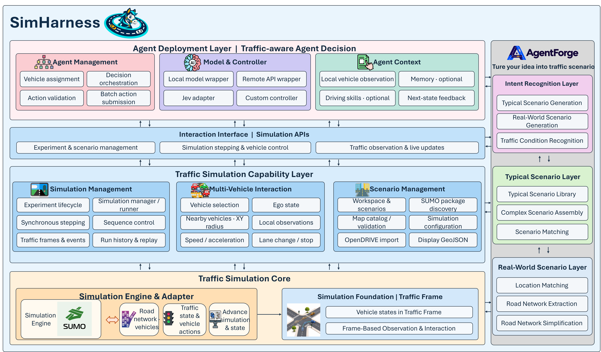

<p align="center">
  
</p>

<h1 align="center">SimHarness</h1>

<p align="center">
  <a href="https://github.com/TaoLbr1993/SimHarness/stargazers"></a>
  
  
  <a href="LICENSE"></a>
</p>

<p align="center">An agent harness for traffic simulation, connecting agents and vehicle control through a simulation-centered workflow.</p>

<p align="center">English · <a href="README.zh-CN.md">简体中文</a> · <a href="docs/en/index.md">English Documentation</a> · <a href="docs/index.md">中文文档</a></p>

## SimHarness

SimHarness is an **agent-native harness for traffic simulation**. With a single command, it can connect local LLMs, LLM APIs, and Jev-style decision models to a traffic simulation. It also provides components such as Memory and Skills for traffic agents, making it easier to set up and run simulations.

### Core Features

- **Agent Native:** Run traffic simulations with local or remote LLM services, Jev, or custom agents. SimHarness provides a workflow for assigning vehicles, calling models, and submitting actions, with optional Memory and driving-style Skills.

- **Simulation-Centric:** SimHarness is built around the traffic simulation loop. It provides interfaces for observing vehicles and nearby traffic and controlling selected vehicles, allowing LLM agents to interact with the simulation. The same scenario can also accommodate rule-based policies and other non-model algorithms.

### Functionality

- **Vehicle observation and control:** Simulate observations of nearby vehicles with customizable observation rules, and control vehicles through predefined actions for speed, acceleration, lane changes, and stopping.
- **External agent integration:** Connect agent APIs, local LLM agents, or Jev-style decision models at the scenario or individual-vehicle level.
- **Memory and Skills:** Integrate Memory to record and recall each vehicle's driving experiences, and use Skills to define agent driving styles.
- **Visualization and replay:** View traffic in the desktop interface and save, inspect, and replay simulation runs.
- **[TrafficForge](trafficforge/README.md):** Generate synthetic or real-world road networks and traffic demand from natural-language scenario descriptions.

### Architecture



SUMO is the source of traffic state. In external control mode, the simulation waits for a program to submit actions before advancing. Vehicles without actions are controlled by SUMO. Local observations currently filter SUMO state by XY distance; they do not simulate sensor errors or occlusion.

## News

- **(2026-11-07)** [TrafficForge](trafficforge/README.md) is released! TrafficForge turns your idea into a traffic simulation scenario with one sentence.
- **(2026-11-02)** SimHarness is released.

## Demo Videos

### SimHarness

Agent integration and traffic simulation.

https://github.com/user-attachments/assets/78188fdb-efac-4f2d-8348-596898ca8b83

### TrafficForge

From natural-language descriptions to traffic scenarios.

https://github.com/user-attachments/assets/a48477ee-b25e-4388-a120-cd2fb3b99ecf

## Quick Start

Run a SUMO scenario and optional agents with one command, without starting a desktop UI or a separate backend.

### Prerequisites

- Python 3.10 and [uv](https://docs.astral.sh/uv/).
- [SUMO](https://sumo.dlr.de/docs/Downloads.php), with `sumo` on `PATH` or in an installed Python `sumo` package.

### Installation

```bash
git clone https://github.com/TaoLbr1993/SimHarness.git
cd SimHarness
uv sync --frozen --extra sumo
```

### Run a Scenario

```bash
uv run simharness run --config configs/headless.example.yaml --scenario image2road
```

The command starts a temporary local backend, creates and runs the experiment, and shuts it down when finished. `--scenario` selects a SUMO scenario ID discovered under `configs/maps/`.

The [example configuration](configs/headless.example.yaml) defaults to `bindings: []`: no model is called, and SUMO controls all vehicles. Each run saves its summary and per-step requests and observations under `artifacts/headless/<run-id>/`. With no bindings, no selected-vehicle observations are recorded.

The legacy `trafficverse` command remains available, as do existing Python imports and environment variables.

### Connect an Agent

To control vehicles, copy the example configuration and replace the empty `bindings` with a model and vehicle assignment:

```yaml
bindings:
  - name: api_driver
    wrapper: trafficverse.agent_harness.models.api:ApiModel
    vehicle_ids: [car_001]  # Replace with a vehicle ID in the scenario.
    model:
      base_url: https://example.com/v1
      model_id: your-model
      api_key_env: MODEL_API_KEY
      timeout_s: 30
```

Set `MODEL_API_KEY` in the environment before running; the YAML contains only the variable name. Replace the URL and model ID with those of your OpenAI-compatible service. Memory and Skills are optional. See the [headless guide](docs/en/headless-run.md) for the full configuration, local models, Jev, and result format.

To use the desktop UI instead, follow [Getting Started](docs/en/getting-started.md). To connect an independent program directly, see the [external control API](docs/en/external-step-api.md).

## Project Structure

```text
SimHarness/
├── src/trafficverse/        # Simulation application, API, SUMO adapter, Agent Harness
├── ui/                      # Desktop interface and map visualization
├── trafficforge/            # Natural-language scene authoring and generation service
├── configs/                 # Scenario, map, and agent configuration
├── contracts/               # API and message contracts
├── docs/                    # Project documentation
├── tests/                   # Unit, contract, and integration tests
└── scripts/                 # Development and asset-processing scripts
```

## Future Features

- Control of other traffic elements, such as traffic lights.
- Support for other simulators, such as highway-env and CARLA.
- Additional observation methods.
- Integration and display of evaluation functions through defined interfaces.
- More agent control modes.

## Documentation

- [Documentation home](docs/en/index.md)
- [Getting started](docs/en/getting-started.md)
- [Run without a desktop](docs/en/headless-run.md)
- [Agent Harness guide](docs/en/agent-harness.md)
- [External control API](docs/en/external-step-api.md)
- [Memory and Skills](docs/en/memory-and-skills.md)
- [Map asset catalog and supported formats](docs/MAP_ASSET_CATALOG.md) (Chinese)
- [Current architecture and data flow](docs/en/architecture.md)
- [System design and target architecture](docs/SYSTEM_DESIGN.md) (Chinese)
- [Agent development guide](docs/AGENT_DEVELOPMENT_GUIDE.md) (Chinese)

Some design documents describe target architectures or historical proposals. Refer to the current implementation and feature guides when using the system.

## Contributing and License

Issues and pull requests are welcome. To run project checks:

```bash
uv run ruff format --check .
uv run ruff check .
uv run mypy src tests
uv run pytest
```

This project is licensed under the [MIT License](LICENSE).
