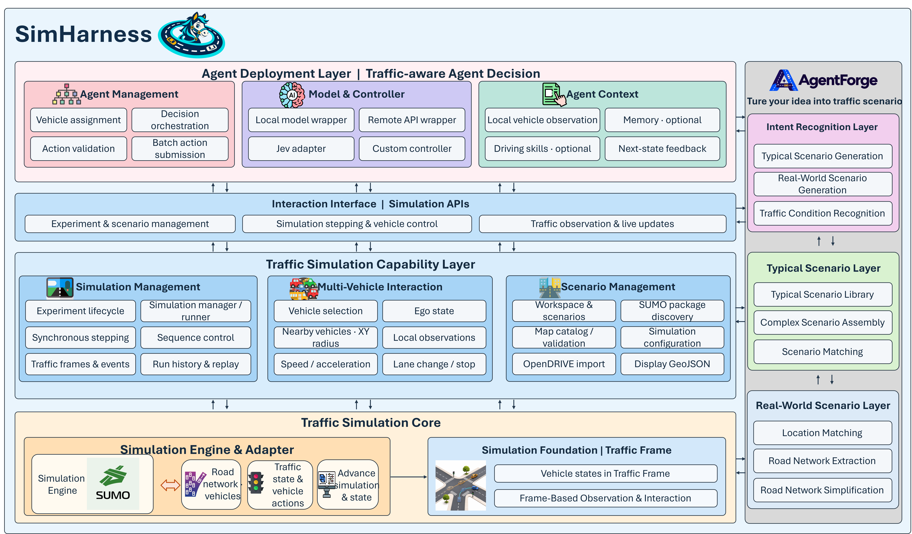

<p align="center">
  
</p>

<h1 align="center">SimHarness</h1>

<p align="center">
  <a href="https://github.com/TaoLbr1993/SimHarness/stargazers"></a>
  
  
  <a href="LICENSE"></a>
</p>

<p align="center">面向交通仿真的智能体 Harness，围绕仿真流程连接智能体与车辆控制。</p>

<p align="center"><a href="README.md">English</a> · 简体中文 · <a href="docs/index.md">中文文档</a> · <a href="docs/en/index.md">English Documentation</a></p>

## SimHarness

SimHarness 是一个面向交通仿真的 **Agent Native Harness**。通过一条命令，SimHarness 可以接入本地大模型、大模型 API 和 Jev 类决策模型。它还提供专为交通仿真设计的 Memory、Skill 等 Harness 组件，方便开展交通仿真。

### 核心特性

- **Agent Native**：通过一条命令和本地或远程大模型服务、Jev 或其他自定义智能体的 API，开展交通仿真。SimHarness 提供车辆分配、模型调用和动作提交等支持大模型智能体的工作流程，以及可选的 Memory 和驾驶风格 Skill。

- **Simulation-Centric**：围绕交通仿真中的交通帧循环构建。在核心仿真软件的基础上，提供车辆及其周边交通观测、指定车辆控制等外部工具，供大模型智能体接入。交通场景也可以容纳规则策略和其他非模型算法。

### 功能概览

- **车辆观测与控制**：模拟车辆对周边车辆的观测，支持自定义观测规则，并通过预定义动作控制车速、加速度、换道与停车。
- **外部智能体接入**：支持在场景级或单车级接入 Agent API 或 Jev 类决策模型。
- **Memory 与 Skill**：接入 Memory，为每辆车记录和调用驾驶记忆；接入 Skill，定义智能体的驾驶风格。
- **可视化与回放**：通过桌面界面查看交通仿真，支持保存、查看和回放正式仿真结果。
- **[TrafficForge 场景工坊](trafficforge/README.md)**：通过自然语言描述交通场景，生成合成或真实地点的路网与交通需求。

### 系统架构



SUMO 是交通状态的来源。外部控制模式下，仿真等待外部程序提交动作，再推进下一步；本轮没有动作的车辆交由 SUMO 控制。车辆观测目前基于 SUMO 状态按平面距离筛选，不模拟传感器误差或遮挡。

## News

- **(2026-11-02)** SimHarness 正式发布。

## 快速开始

无需启动桌面界面或单独启动后端，使用一个命令运行 SUMO 场景及可选的车辆 Agent。

### 环境要求

- Python 3.10 和 [uv](https://docs.astral.sh/uv/)。
- 安装 [SUMO](https://sumo.dlr.de/docs/Downloads.php)，并确保 `PATH` 或已安装的 Python `sumo` 包中有 `sumo` 可执行文件。

### 安装

```bash
git clone https://github.com/TaoLbr1993/SimHarness.git
cd SimHarness
uv sync --frozen --extra sumo
```

### 运行场景

```bash
uv run simharness run --config configs/headless.example.yaml --scenario image2road
```

命令会临时启动本地后端，自动创建并运行实验，结束后关闭实验和后端。`--scenario` 指定 `configs/maps/` 中发现的 SUMO 场景 ID。

[示例配置](configs/headless.example.yaml)默认使用空的 `bindings`：不会调用模型，所有车辆由 SUMO 控制。每次运行的摘要和逐步请求、观测保存在 `artifacts/headless/<运行ID>/`；没有绑定时，不记录选定车辆的局部观测。

原有的 `trafficverse` 命令、Python 导入路径和环境变量继续可用。

### 接入 Agent

要控制车辆，可以复制示例配置，将空的 `bindings` 替换为模型与车辆绑定，例如：

```yaml
bindings:
  - name: api_driver
    wrapper: trafficverse.agent_harness.models.api:ApiModel
    vehicle_ids: [car_001]  # 替换为场景中的实际车辆 ID
    model:
      base_url: https://example.com/v1
      model_id: your-model
      api_key_env: MODEL_API_KEY
      timeout_s: 30
```

运行前将 `MODEL_API_KEY` 设置到环境变量中，YAML 只填写变量名；地址和模型名替换为实际的 OpenAI 兼容服务。Memory 和 Skill 可按需启用。完整配置、本地模型、Jev 和结果格式见[无界面运行指南](docs/HEADLESS_RUN.md)。

如需使用桌面界面，请参见[安装与运行](docs/GETTING_STARTED.md)；如需独立程序直接接入，请参见[外部控制接口](docs/EXTERNAL_STEP_API.md)。

## 项目结构

```text
SimHarness/
├── src/trafficverse/        # 仿真应用、API、SUMO 适配和 Agent Harness
├── ui/                      # 桌面界面与地图展示
├── trafficforge/            # 自然语言场景创作与生成服务
├── configs/                 # 场景、地图和 Agent 配置
├── contracts/               # API 与消息契约
├── docs/                    # 项目文档
├── tests/                   # 单元、契约与集成测试
└── scripts/                 # 开发和资产处理脚本
```

## Future Features

- 支持交通灯等其他交通元素的控制。
- 适配 highway-env、CARLA 等其他仿真工具。
- 提供更多观测方式。
- 通过接口接入和展示评估函数。
- 支持更多 Agent 控制模式。

## 文档

- [文档入口](docs/index.md)
- [安装与运行](docs/GETTING_STARTED.md)
- [无界面运行仿真](docs/HEADLESS_RUN.md)
- [Agent Harness 使用说明](src/trafficverse/agent_harness/README.md)
- [外部程序同步控制车辆](docs/EXTERNAL_STEP_API.md)
- [Memory 与 Skill 设计和使用](docs/AGENT_MEMORY_SKILL_DESIGN.md)
- [地图资产目录与支持格式](docs/MAP_ASSET_CATALOG.md)
- [当前架构与数据流](docs/ARCHITECTURE.md)
- [系统设计与目标架构](docs/SYSTEM_DESIGN.md)
- [Agent 开发指南](docs/AGENT_DEVELOPMENT_GUIDE.md)

部分系统设计文档包含目标架构和历史方案，使用时请结合当前代码与对应功能说明。

## 贡献与许可证

欢迎通过 GitHub Issue 反馈问题或提出建议，也欢迎通过 Pull Request 参与改进。运行项目检查：

```bash
uv run ruff format --check .
uv run ruff check .
uv run mypy src tests
uv run pytest
```

本项目采用 [MIT 许可证](LICENSE)。
